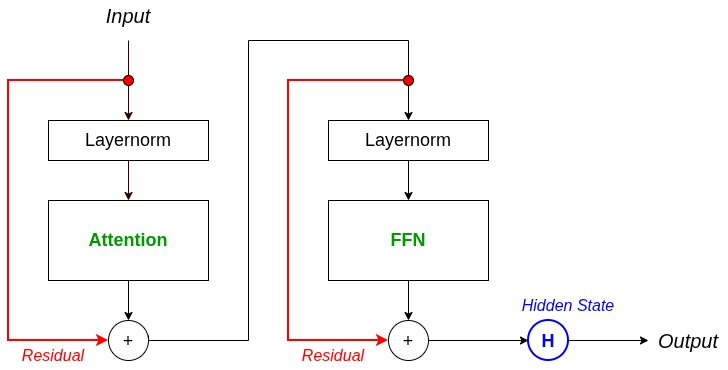
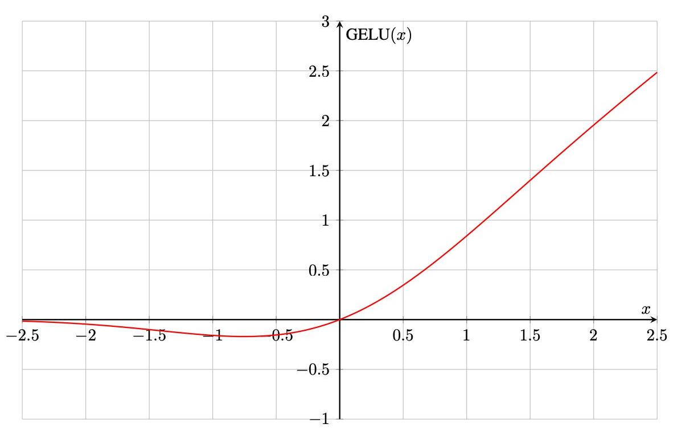

# Transformer Block and Its Basic Operators

With an understanding of vector operations and matrix multiplication, we have finally arrived at the doorstep of the Transformer Block, one solid step at a time.

The Transformer Block is the fundamental building block of a Transformer.

Therefore, mastering the essentials of the Transformer Block means understanding the foundation of LLMs and holding the key to implementing GPT.

## Transformer Block

### The Relationship Between a Transformer and Transformer Blocks

A Transformer consists of multiple Transformer Blocks, as illustrated below:

```text
               +-------------------+               +-------------------+      +-----------+
Embedding ---> | Transformer Block | ---> ... ---> | Transformer Block | ---> | Generator |
               +-------------------+               +-------------------+      +-----------+
                                                             |
                                                             |                +-----------+
                                                             +--------------> |  Trainer  |
                                                                              +-----------+
```

This is generally called a multilayer Transformer, with each Transformer Block referred to as a layer.

Each Transformer Block connects to the next layer through the Hidden State at its output. The final Transformer Block also connects to the Generator and Trainer through its output Hidden State.

Naturally, we might ask: what does a Transformer Block look like on the inside?

### Inside a Transformer Block

A Transformer Block consists of four parts: Attention, FFN, Residual, and the output Hidden State mentioned earlier. Its structure is illustrated below:



Attention is the famous attention mechanism and the core design of the Transformer.

Attention uses a series of matrix multiplications and the Softmax operator to cleverly identify relationships between Tokens and uncover the information those relationships represent or imply.

FFN provides the Transformer with a computational path different from Attention. By applying nonlinear feature transformations to individual vectors, it enhances the model's expressive power.

In the next two articles, we will take a detailed look at Attention and FFN, respectively.

Residual adds the input of each transformation component (Attention or FFN) to the result of that transformation to obtain the final output, namely $`Output = x + F(x)`$. With Residual, through appropriate training, we can adjust each transformation component (Attention and FFN, here and below) to produce an incremental change to its input.

Why do we need to do this? Wouldn't it be simpler to train and adjust each transformation component so that its result could directly serve as the final output? Let's leave that question unanswered for now. The answer will become clear when we discuss the Trainer and gradient descent.

Finally, there is the output Hidden State we mentioned earlier. It might not really count as a separate part, since it is simply the output of FFN after the Residual addition. However, it plays an important role in connecting subsequent Transformer Blocks, as well as the Generator and Trainer, so it deserves its own discussion. During training, it serves as a bridge for gradient propagation between layers and between inputs and outputs. During text generation, it links the model's computations to the selection of the Embedding to generate and the output Token.

In the diagram and the discussion above, we can also see some basic operators, such as LayerNorm, Softmax, and GeLU. What computations do they perform, and what are those computations for?

## Basic Operators in a Transformer Block

### LayerNorm Operator

During both model training and text generation, we would like the input to have a mean of 0 and a variance of 1 at certain points, such as just before a transformation is performed.

Why would we want that? Because inputs with a mean of 0 and a variance of 1 are more flexible and easier to work with when training and adjusting a model.

But why exactly are inputs with a mean of 0 and a variance of 1 more friendly to model training and adjustment?

That is a long story, and the mathematics behind it is relatively complicated. For now, let's accept this conclusion. If you are interested in the details, the usual rule applies: let me know. If enough people are interested, I will write a separate article to explain and prove it.

The LayerNorm operator helps us standardize the input. In other words, we **hope** to bring its mean to 0 and its variance to 1.

By "hope", we mean that standardization is intended to achieve this effect, but we do not require the final output of LayerNorm to maintain that state at all times.

Suppose we have an input vector $`x`$. The LayerNorm operator is defined as:

$$ Layernorm(x, \gamma, \beta) = \gamma \odot Std(x) + \beta $$

where

$$ Std(x)_{i} = \frac{x_{i} - \mu}{\sqrt{\sigma^2 + \epsilon}} $$

Here, $`\mu`$ is the mean of the components of vector $`x`$, $`\sigma^2`$ is their variance, and $`\epsilon`$ is a small constant that ensures the denominator is not zero.

You might ask: if all we want is to give the input vector $`x`$ a mean of 0 and a variance of 1, wouldn't $`Std(x)`$ be enough? It subtracts the mean from each component and divides by the standard deviation. Why do we also need the vectors $`\gamma`$ and $`\beta`$? And after applying those scaling and shifting coefficients, wouldn't the "mean of 0, variance of 1" state be lost? In fact, this is exactly what we meant by "hope" earlier. Let's keep the answer a mystery for now and reveal it when we discuss the Trainer.

### Softmax Operator

In the first article, "[What Are the Main Components of a Complete LLM?](v0_01.md)", we mentioned that an LLM is a probabilistic model. Given the current input text, it predicts which Token is most likely to come next.

Therefore, probability-related computations are essential in an LLM. The Softmax operator performs such computations.

Softmax maps a set of real numbers to a discrete probability distribution. For a vector $`x`$, it is defined as:

$$ Softmax(x)_{i} = \frac{\exp(x_i)}{\sum_{j = 1}^{n} \exp(x_j)} $$

Why use Softmax instead of simply dividing each element by the sum of all elements to calculate probabilities? Because not every component of a vector is necessarily positive, while probabilities must be nonnegative numbers in the range [0, 1], and all probabilities must sum to 1. Softmax uses the nonnegative nature of the exponential function with base $`e`$, together with the operation of dividing the current element's $`\exp`$ value by the sum of all elements' $`\exp`$ values, to satisfy both requirements. Moreover, the exponential function with base $`e`$ is differentiable everywhere, which is very convenient for subsequent gradient-based training.

### GeLU Operator

The GeLU operator is mainly used in the FFN to provide the ability to apply nonlinear transformations to vectors. For a vector $`x`$, it is defined as:

$$ GeLU(x)_{i} = GeLU(x_i) = x_i P(Y \le x_i) = x_i \int_{-\infty}^{x_i}\frac{1}{\sqrt{2\pi}}\exp(-\frac{t^{2}}{2})dt = \frac{1}{2} x_i \left[1+\text{erf}\left(\frac{x_i}{\sqrt{2}}\right)\right], \quad Y\sim\mathcal N(0,1) $$

Looking at this formula, some of you are probably thinking: I have no idea what any of this means. What on earth is going on here...?

Don't worry. Especially for those of us with engineering backgrounds, myself included, not understanding it is perfectly normal. Understanding it at first glance would be the surprising part, haha.

In practice, we generally use an approximate, simplified version of GeLU:

$$ GeLU(x)_{i} = GeLU(x_i) \approx 0.5x_i \left(1 + \tanh \left[\sqrt{\frac{2}{\pi}}\left(x_i + 0.044715 x_i^{3}\right)\right]\right) $$

That looks much simpler and more elegant, doesn't it? But it is still not intuitive enough for understanding what the function does.

I believe the most intuitive way for humans to understand a function is still one of the oldest methods: looking at its graph. Here is the graph of GeLU:



Now it is clear, isn't it? That's right. The GeLU operator tries to preserve the original value of positive numbers while bringing negative numbers closer to 0.

Why use such a simple approach, "preserving positive values and suppressing negative values" for each component of a vector, to give the Transformer nonlinear transformation capabilities? Isn't that too simple? And if so, why use a relatively complicated operator like GeLU? Let's leave another question open. In a later article about FFN, we will compare GeLU with an earlier nonlinear operator, ReLU, and reveal the answer.

## Summary

Although this article is relatively short, it is very important.

The Transformer Block is the fundamental building block of a Transformer. By stacking Transformer Blocks layer by layer, we can construct a complete Transformer. However, it is important to point out that today's popular large models and their variants have different Transformer architectures, which are not necessarily just simple sequential stacks of Transformer Blocks.

Transformer Blocks also involve basic operators such as LayerNorm, Softmax, and GeLU. Understanding how they are computed and what they do will not only help us avoid unnecessary detours as we explore the Transformer in later articles, but also give us a deeper and clearer understanding of it.
