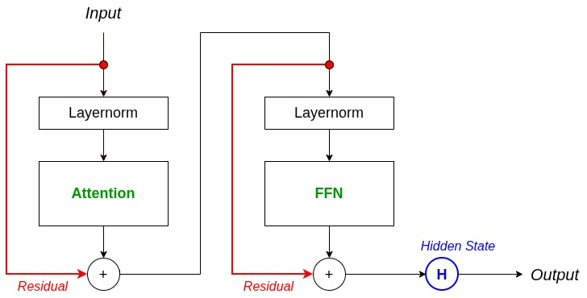
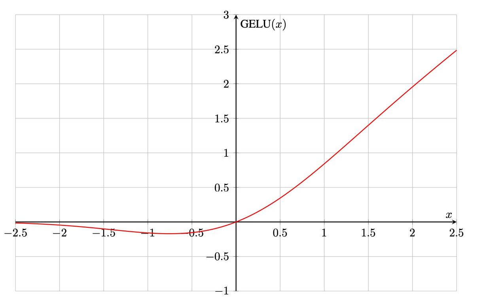

# Transformer Block 及其基本算子

在理解向量运算和矩阵乘法的基础上，我们扎扎实实地来到了 Transformer Block 的门前。

Transformer Block 是 Transformer 的基本构建单位。

因此，掌握了 Transformer Block 的精髓，就掌握了 LLM 的根基，也就掌握了开启 GPT 实现的钥匙。

## Transformer Block

### Transformer 与 Transformer Block 的关系

一个 Transformer 由多个 Transformer Block 组成。如下图所示：

```text
               +-------------------+               +-------------------+      +-----------+
Embedding ---> | Transformer Block | ---> ... ---> | Transformer Block | ---> | Generator |
               +-------------------+               +-------------------+      +-----------+
                                                             |
                                                             |                +-----------+
                                                             +--------------> |  Trainer  |
                                                                              +-----------+
```

一般把这种 Transformer 称做多层 Transformer，每个 Transformer Block 称为一层。

每层 Transformer Block 都通过其尾端的 Hidden State 连接下一层，最后一层的 Transformer Block 也是通过尾端 Hidden State 连接 Generator 和 Trainer。

我们很自然地会问，Transformer Block 的内部长成什么样子呢？

### Transformer Block 内部结构

一个 Transformer Block 由四部分组成：Attention，FFN，Residual，以及刚才说过的尾端 Hidden State。其结构如下图所示：



Attention 就是大名鼎鼎的注意力机制，也是 Transformer 的核心设计。

Attention 使用一系列的矩阵乘法以及 Softmax 算子，巧妙地提取 Token 之间的关联，以及发掘这些关联所代表或衍生的信息。

FFN 为 Transformer 提供了一条与 Attention 不同的计算路径，通过对逐个向量的非线性特征变换，增强模型的表达能力。

接下来的两篇我们会专门地，详细地拆解 Attention 和 FFN。

Residual 是把每个变换部分（Attention 和 FFN）的输入加到变换结果之上得到最终输出，即 $`Output = x + F(x)`$。使用 Residual，经过合理适当的训练，我们可以把每个变换部分（Attention 和 FFN，下文同）调整为对于输入的增量变换。

为什么需要这样做呢？直接把变换部分的结果，通过适当训练和调整，使其成为最终输出，减少复杂性，不是更好吗？对于这个问题，我们这里还是先卖个关子，等聊到 Trainer 和梯度下降的时候，答案自然揭晓。

最后就是我们上文提到的，尾端的 Hidden State 了。它也许算不上一个部分，因为它只是 FFN 经过 Residual 之后的输出。但它在连接后续的 Transformer Block 以及 Generator 和 Trainer 的过程中起到重要作用，因此这里单拿出来说一说。它在训练过程中，是层与层之间，输入与输出之间，梯度传播的桥梁；在生成文本过程中，是连接模型计算，选择生成 Embedding 和输出 Token 的纽带。

在图中和上文中，我们还可以看到一些基本算子，如 Layernorm，Softmax 和 GeLU。它们都做了什么计算，这些计算的用途又是什么呢？

## Transformer Block 中的基本算子

### Layernorm 算子

无论在模型训练还是生成过程当中，我们希望在某些特定时刻，比如一个变换即将执行时，其输入的均值为 0，方差为 1。

为什么会有这种希望呢？因为均值为 0，方差为 1 的输入，对模型的训练和调整，是更加灵活友好的。

那又是为什么，均值为 0，方差为 1 的输入，对模型的训练和调整，更加灵活友好呢？

这个问题说来话长，涉及到的数学原理也相对复杂。我们先接受这个结论，如果有兴趣知道具体原因，还是老规矩，告诉我，人数多了，开番外篇详细讨论证明。

Layernorm 算子就是帮助我们将输入标准化的算子，即**期待**将均值变为 0，方差变为 1 的算子。

所谓“期待”，是指我们希望通过标准化获得这样的效果，但并不要求 LayerNorm 的最终输出始终保持这一状态。

假如我们有输入向量 $`x`$，则 Layernorm 算子的定义是：

$$ Layernorm(x, \gamma, \beta) = \gamma \odot Std(x) + \beta $$

其中，

$$ Std(x)_{i} = \frac{x_{i} - \mu}{\sqrt{\sigma^2 + \epsilon}} $$

其中，$`\mu`$ 是向量 $`x`$ 各个分量的均值，$`\sigma^2`$ 是向量 $`x`$ 各个分量的方差，$`\epsilon`$ 是一个小常数，确保分母不为 0。

你可能会问，如果只是让输入向量 $`x`$ 均值为 0，方差为 1，那么 $`Std(x)`$ 在每个分量上减去均值，除以标准差，就可以满足要求了。为什么还需要向量 $`\gamma`$ 和 $`\beta`$ 参与其中呢？另外，乘加系数之后，“均值为 0，方差为 1”这个状态不是就被打破了吗？其实，这就是刚才所说的“期待”的具体体现了。我们这里还是卖个关子，等聊到 Trainer 的时候揭晓答案。

### Softmax 算子

第一篇“[一个完整的 LLM 由哪些部分组成](v0_01.zh_CN.md)”里面说过，LLM 是一种概率模型，即根据当前输入的文本，预测哪个 Token 是下一个文本的概率最大。

因此，在 LLM 中一定少不了概率相关的计算。这种概率相关的计算由 Softmax 算子实现。

Softmax 是将一组实数映射为一个离散概率分布的算子。对于向量 $`x`$，它的定义是：

$$ Softmax(x)_{i} = \frac{\exp(x_i)}{\sum_{j = 1}^{n} \exp(x_j)} $$

为什么要用 Softmax 算子而不直接使用“当前元素除以所有元素之和”的方式计算概率呢？因为向量中不一定所有分量都是正值，而概率必须是在 [0, 1] 之间的非负数，且所有变量的概率加和必须为 1。Softmax 算子使用 $`e`$ 的指数函数的非负特性，以及“当前元素 $\exp$ 值除以所有元素 $`\exp`$ 值之和”的运算，同时满足了这两个要求。而且，以 $`e`$ 为底的指数函数还能保证处处可微，这为后续的基于梯度的训练提供了很大方便。

### GeLU 算子

GeLU 算子主要用于 FFN 部分当中，提供对向量进行非线性变换的能力。对于向量 $`x`$，它的定义是：

$$ GeLU(x)_{i} = GeLU(x_i) = x_i P(Y \le x_i) = x_i \int_{-\infty}^{x_i}\frac{1}{\sqrt{2\pi}}\exp(-\frac{t^{2}}{2})dt = \frac{1}{2} x_i \left[1+\text{erf}\left(\frac{x_i}{\sqrt{2}}\right)\right], \quad Y\sim\mathcal N(0,1) $$

看到这个公式，肯定有人会说，看不懂啊，这什么乱七八糟的……

别着急，尤其工程师出身的人，包括我在内，看不懂是应该的，看得懂才是比较神奇，哈哈。

在实际应用当中，我们一般会采用 GeLU 的近似简化版：

$$ GeLU(x)_{i} = GeLU(x_i) \approx 0.5x_i \left(1 + \tanh \left[\sqrt{\frac{2}{\pi}}\left(x_i + 0.044715 x_i^{3}\right)\right]\right) $$

这个看起来就简单漂亮多了是不是？但对于理解来说，还是不够直观。

我认为，人类理解函数最直观的方式，依然是最古老的那种，通过函数的图像。GeLU 函数的图像是：



这回就一目了然了吧？没错，GeLU 算子的作用正是：对于正数，尽量保持其原值，而对于负数，尽量使其靠近 0。

为什么要用这种对向量每个分量“保持正数，抑制负数”的简单方式，来提供 Transformer 中非线性变换的能力呢？会不会过于简单了？如果是这样的话，又为什么要用 GeLU 这种相对复杂的算子呢？我们还是先卖个关子，在后续拆解 FFN 的篇目里，我们会比较 GeLU 和另外一种早期的非线性算子 ReLU，并揭晓这个问题的答案。

## 总结

本篇虽然篇幅较短，但十分重要。

Transformer Block 是 Transformer 的基本构建单位。通过 Transformer Block 的逐层堆叠，我们就可以构造出完整的 Transformer。但必须指出的是，目前流行的各种大模型及其子版本，都有各自不同的 Transformer 结构，未必是这样简单的 Transformer Block 串联堆叠。

Transformer Block 还涉及到了 Layernorm，Softmax，GeLU 等基本算子。掌握了它们的计算方法和作用，后续我们拆解 Transformer 的时候，不仅可以少走很多弯路，还会使我们对 Transformer 的理解更加深入透彻。
